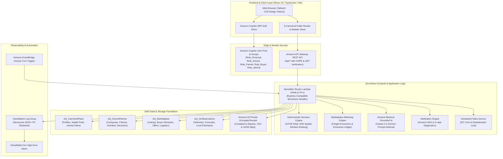

# Unified Environmental Intelligence Platform
### Personal Air Copilot • School Air Safety Planner • Parali-to-Value Marketplace

A unified, serverless environmental intelligence platform engineered for **Delhi-NCR, Punjab, and Haryana**. It combines CPCB National Air Quality Index (NAQI) telemetry, numerical atmospheric chemistry dispersion forecasts, multi-tenant institutional safety planning, and stubble (parali) valorization economics to protect public health and mitigate seasonal agricultural burning.

---

## 1. Unified System Overview & Architecture Diagram

The system employs a modern AWS Serverless architecture designed for near-zero idle cost, high availability, sub-second regional API response times, and strict multi-tenant boundary enforcement.



---

## 2. Monorepo Organization & Directory Hierarchy

The project is structured as a TypeScript monorepo with clean separation of concerns:

```
Air_Quality_Intelligence/
├── frontend/                     # React 19 single-page application (SPA)
│   ├── src/
│   │   ├── components/
│   │   │   ├── common/           # Header, Footer, ProvenanceBadge, NotificationCenter
│   │   │   ├── auth/             # Real Cognito SRP authentication modal & forms
│   │   │   ├── personal/         # Personal Air Copilot views & diurnal planners
│   │   │   ├── school/           # School Air Safety Planner & policy matrix
│   │   │   └── marketplace/      # Parali Marketplace, matching engine & logistics
│   │   ├── services/             # cognitoAuth.ts, apiClient.ts
│   │   ├── types/                # Shared frontend domain interfaces & enums
│   │   ├── index.css             # Tailwind token definitions
│   │   └── App.tsx               # Canonical router & route guard definitions
│   ├── package.json
│   ├── vite.config.ts
│   └── tailwind.config.js
│
├── backend/                      # Serverless API microservices & business domain
│   ├── src/
│   │   ├── index.ts              # API Gateway Lambda router entry point
│   │   ├── types/                # Domain types & 14 persistent entities
│   │   ├── middleware/           # auth.ts (Cognito JWT verification & RBAC guards)
│   │   ├── repositories/         # Domain repositories & DynamoDB adapters
│   │   │   ├── config.ts         # Persistence mode detection
│   │   │   ├── repositoryFactory.ts # Composition root for DynamoDB vs in-memory
│   │   │   ├── dynamoDbUserRepository.ts
│   │   │   ├── dynamoDbSchoolRepository.ts
│   │   │   ├── dynamoDbMarketplaceRepository.ts
│   │   │   ├── dynamoDbAirRepository.ts
│   │   │   └── dynamoDbAuditRepository.ts
│   │   └── services/             # Core engines & integrations
│   │       ├── cpcbNaqi.ts       # Official CPCB NAQI calculation engine
│   │       ├── airQualityService.ts # IDW spatial interpolation & Open-Meteo
│   │       ├── decisionEngine.ts # Copilot candidate window ranking
│   │       ├── schoolPolicyEngine.ts # Age-bracket school policy thresholds
│   │       ├── matchingEngine.ts # Marketplace matching & transport economics
│   │       ├── bedrockClient.ts  # Grounded Amazon Bedrock assistant
│   │       ├── notificationService.ts # Multi-channel templated notifications
│   │       ├── scheduledTasksService.ts # Background cron job coordinator
│   │       └── logger.ts         # Structured JSON logger with PII sanitization
│   ├── tests/                    # 16 test suites covering 113 automated tests
│   └── package.json
│
├── infrastructure/               # AWS Cloud Development Kit (CDK) definition
│   ├── bin/
│   │   └── app.ts                # CDK application entry point
│   ├── lib/
│   │   └── backend-stack.ts      # CloudFormation infrastructure stack definition
│   ├── cdk.json
│   └── package.json
│
├── REQUIREMENTS_TRACEABILITY.md  # 1-to-1 requirement traceability matrix (Prompts 0-10)
├── package.json                  # Root monorepo workspace scripts
└── README.md                     # Comprehensive architecture and operational guide
```

---

## 3. Complete List of 9 Canonical Public Routes

The frontend router strictly maintains the 9 canonical public routes required by the frozen specification:

1. `/` — **Homepage & Platform Mission**: High-level regional air context across Delhi-NCR, Punjab, and Haryana, summary of the three product modules, live air quality teaser, and platform value proposition.
2. `/how-it-works` — **Operational Architecture & Methodology**: Deep dive into CPCB NAQI linear interpolation, Copernicus CAMS dispersion modeling, IDW spatial interpolation, and biomass logistics supply chains.
3. `/air-quality` — **Regional Air Quality Explorer**: Interactive spatial map and monitoring station inspector with telemetry timestamps, sub-index breakdowns, and provenance transparency badges.
4. `/marketplace` — **Parali-to-Value Public Marketplace**: Overview of stubble valorization, crop residue types, off-taker industries (Bio-CNG, 2G Ethanol, Biomass Pellets), freight economics, and environmental impact calculator.
5. `/about-data` — **Data Governance, Provenance & Scientific Methodology**: Transparent breakdown of data sources (DPCC, CPCB, HSPCB, PPCB, Open-Meteo), uncertainty modeling, and non-clinical health disclaimers.
6. `/sign-in` — **Secure Authentication (Sign In)**: Amazon Cognito SRP credential validation with role-based dashboard redirection.
7. `/sign-up` — **Registration & Role Onboarding**: Self-service account registration with email verification and persona selection.
8. `/privacy` — **Privacy Policy & Regulatory Compliance**: Explicit caregiver consent guidelines, non-clinical medical notices, location privacy policies, and DPDP Act compliance.
9. `/demo` — **Guided Walkthrough & Persona Switcher**: Seamless live exploration across pre-seeded demonstration accounts (`parasnath@gmail.com`, `sunilnagrale@gmail.com`, `kvkailashahar@gmail.com`) without counterfeit tokens.

---

## 4. Three Integrated Product Modules

### 4.1. Personal Air Copilot
- **Deterministic Activity Planner**: Evaluates candidate outdoor time windows for cardiovascular activities (running, walking, outdoor gym, shopping) across the 72-hour forecast horizon.
- **Diurnal Suitability Scoring**: Factors in regional atmospheric dynamics—morning boundary layer temperature inversions versus afternoon solar dispersion.
- **Health Sensitivity Penalties**: Multipliers for asthma, cardiovascular conditions, elderly individuals, and young children (strictly non-clinical advisory).
- **Caregiver Consent Verification**: Mandatory explicit verification prior to dispatching parental/caregiver precautionary alerts.
- **Truthful Status Indicators**: Clear differentiation between measured observations, numerical forecasts, and modelled spatial estimates.

### 4.2. School Air Safety Planner
- **Multi-Campus Institutional Management**: Manages multi-campus schools (e.g. Kendriya Vidyalaya Kailashahar, KV Delhi Cantt).
- **Age-Bracket Policy Matrix**: Configurable precautionary AQI thresholds for Primary (Ages 5–10), Middle (Ages 11–14), and Senior (Ages 15–18) students.
- **Automated Mitigation Workflows**: Triggers mandatory indoor auditorium migration or afternoon postponement when scheduled outdoor sports breach policy thresholds.
- **Administrative Sign-Off Lifecycle**: Explicit operational separation between Automated System Recommendations and Official Principal / Administrator Sign-Off.
- **Compliance Export**: Generates auditable compliance reports and event logs.

### 4.3. Parali-to-Value Marketplace
- **Crop Residue Catalog**: Stubble listings from Punjab and Haryana (Sangrur, Ludhiana, Karnal, Patiala) specifying crop type, moisture content, baling format, tonnage, and ex-farm price.
- **Industrial Demand Registry**: Off-taker specifications for Biomass Pellet Manufacturers, Bio-CNG / CBG Plants, 2G Bio-Ethanol Refineries, and biodegradable tableware manufacturers (referencing Kriya Labs IIT Delhi).
- **Algorithmic Match & Freight Calculator**: Calculates haversine distance and Northwest India 16T truck freight economics ($\text{INR } 250/\text{t base} + \text{INR } 4.5/\text{t-km}$).
- **Binding Offer Negotiations**: Structured lifecycle with terminal state protection against invalid mutations.
- **5-Stage Logistics Pipeline**: Milestone progression (`SCHEDULED` $\rightarrow$ `LOADING` $\rightarrow$ `IN_TRANSIT` $\rightarrow$ `DELIVERED` $\rightarrow$ `VERIFIED`) with field and factory weighbridge certifications.
- **Environmental Impact Ledger**: Rigorous avoidance metrics ($1.46\text{ t }CO_2e/\text{t}$ and $3.0\text{ kg }PM_{2.5}/\text{t}$) calculated strictly against verified delivery slips.

---

## 5. CPCB NAQI Engine & Provenance Safeguards

The air quality calculation is implemented in [`backend/src/services/cpcbNaqi.ts`](file:///d:/Air_Quality_Intelligence/backend/src/services/cpcbNaqi.ts) conforming to the official Ministry of Environment, Forest and Climate Change (MoEFCC) National Air Quality Index standards:

$$\text{Sub-Index } I_p = \frac{I_{HI} - I_{LO}}{B_{HI} - B_{LO}} \cdot (C_p - B_{LO}) + I_{LO}$$

$$\text{Overall AQI } = \max(I_{PM2.5}, I_{PM10}, I_{NO2}, I_{SO2}, I_{CO}, I_{O3})$$

### Regulatory Safeguards:
1. **Minimum Pollutant Rule**: AQI calculation requires data for at least 3 criteria pollutants, of which at least one must be particulate matter ($PM_{2.5}$ or $PM_{10}$). If this condition is not met, the engine returns `isSufficientData: false` and `aqi: null`, triggering fallback to spatial interpolation or manual review.
2. **Telemetry Staleness Flags**: Observations older than 4 hours are flagged as `isStale: true` and downgraded to prevent misinforming administrative school decisions.
3. **Provenance Badging**: Every data point is tagged with an immutable provenance tag:
   - `MEASURED_OBSERVATION` (Physical CPCB/DPCC continuous monitoring station telemetry)
   - `FORECAST` (Atmospheric chemistry forecast model from Copernicus CAMS via Open-Meteo)
   - `MODELLED_ESTIMATE` (Inverse Distance Weighted spatial interpolation with computed uncertainty $\pm \sigma$)
   - `DEMO_DATA` (Synthetic benchmark data clearly marked in demo environments)

---

## 6. Role-Based Access Control & Strict Tenant Isolation

The platform enforces five distinct persona roles backed by Amazon Cognito User Pool Groups:

| Persona Role | Cognito Group | Permitted Operations | Tenant Isolation Key |
| :--- | :--- | :--- | :--- |
| **`PERSONAL_USER`** | `Role_Personal` | Manage personal profile, sensitivity prefs, activity plans, caregiver alerts | `userId` |
| **`SCHOOL_ADMIN`** | `Role_School` | Institutional profile, multi-campus management, policy matrix, activity decisions | `schoolId` |
| **`FARMER`** | `Role_Farmer` | Create stubble listings, review/negotiate offers, track collection logistics | `farmerId` |
| **`BUYER`** | `Role_Buyer` | Manage plant demands, submit offers, update weighbridge slips, view impact ledger | `buyerId` |
| **`PLATFORM_ADMIN`** | `Role_Admin` | View global telemetry, system health, audit trail logs, platform diagnostics | Global |

### Zero Fake Sessions Policy
The frontend contains zero mock token generators, counterfeit session bypasses, or client-side role toggles. All authenticated requests pass genuine cryptographically-verified Cognito JWT tokens in the `Authorization: Bearer <token>` header, verified server-side by [`backend/src/middleware/auth.ts`](file:///d:/Air_Quality_Intelligence/backend/src/middleware/auth.ts).

---

## 7. AWS Serverless Architecture & CDK Synthesis

The infrastructure is declared in AWS Cloud Development Kit (CDK v2) in [`infrastructure/lib/backend-stack.ts`](file:///d:/Air_Quality_Intelligence/infrastructure/lib/backend-stack.ts).

Synthesizing the stack creates an AWS CloudFormation template with zero external dependencies:

```bash
cd infrastructure
npm run build
npx cdk synth
```

Synthesis outputs:
- **`AirQualityRestApi`**: Regional API Gateway with binary media types, mock CORS OPTIONS handlers, and `{proxy+}` ANY routing.
- **`AQApiGatewayRouterFunction`**: Monolithic Lambda router in Node.js 24.x with 512 MB memory, 15-second timeout, and least-privilege IAM policies.
- **`AirQualityUserPool`**: Cognito User Pool with email sign-in, preventUserExistenceErrors, password policies, and 5 RBAC groups.
- **`AQAssetsBucket`**: Private S3 bucket with Block Public Access, S3-managed encryption, SSL enforcement, and auto-delete lifecycle.
- **`AQApiGatewayLogGroup`**: CloudWatch Log Group with 14-day retention and metric filter for 5xx server errors.
- **`AQHighServerErrorAlarm`**: CloudWatch Alarm triggering when error rate $\ge 10$ errors in 5 minutes.
- **`AQHourlyRefreshRule`**: EventBridge Scheduled Rule triggering hourly background telemetry cache sync.

---

## 8. Amazon DynamoDB Production Table Inventory & Schemas

Four focused domain tables support high throughput, bounded single-digit millisecond latency queries, and strict multi-tenant boundary isolation:

| Logical Name | Physical Table Name | Partition Key (PK) | Sort Key (SK) | GSIs (with PK/SK) | TTL Attribute | Removal Policy | Repository Class | Primary Entities Stored |
| :--- | :--- | :--- | :--- | :--- | :--- | :--- | :--- | :--- |
| `AQUsersTable` | `AQ_UsersAndPlans` | `PK` (`USER#<userId>`, `IDEMP#<key>`, `AUDIT#<entityId>`) | `SK` (`PROFILE`, `HEALTH_PREFS`, `ALERTS`, `CONSENT`, `PLAN#<planId>`, `LOCK`, `EVENT#<ts>#<id>`) | **GSI1**: `GSI1PK` (`ROLE#<role>`, `ACTOR#<actorId>`), `GSI1SK` (`EMAIL#<email>`, `EVENT#<ts>`) | `ttl` | `dataRemovalPolicy` (Retain in prod, Destroy in dev) | `DynamoDbUserRepository`, `DynamoDbAuditRepository` | User Profiles, Health Preferences, Copilot Activity Plans, Idempotency Locks, Single-Table Audit Event Logs |
| `AQSchoolTable` | `AQ_SchoolPlanner` | `PK` (`SCHOOL#<schoolId>`) | `SK` (`PROFILE`, `POLICY#<ageGroup>`, `CAMPUS#<campusId>`, `ACTIVITY#<activityId>`) | **GSI1**: `GSI1PK` (`SCHOOL#<schoolId>`), `GSI1SK` (`DATE#<date>#<activityId>`) | None | `dataRemovalPolicy` (Retain in prod, Destroy in dev) | `DynamoDbSchoolRepository` | School Profiles, Multi-Campus Facilities, Institutional Policies, Evaluated Student Activities, Administrative Sign-Offs |
| `AQMarketplaceTable` | `AQ_Marketplace` | `PK` (`LISTING#<listingId>`, `BUYER#<buyerId>`, `OFFER#<offerId>`, `COLLECTION#<id>`) | `SK` (`METADATA`, `PROFILE`) | **GSI1**: `FARMER#<id>` / `LISTING#<ts>`, `LISTING#<id>` / `OFFER#<ts>`<br>**GSI2**: `STATUS#<st>` / `DISTRICT#<dst>`, `BUYER#<id>` / `OFFER#<ts>`<br>**GSI3**: `LISTING#<id>` / `OFFER#<ts>`<br>**GSI4**: `BUYER#<id>` / `OFFER#<ts>` | None | `dataRemovalPolicy` (Retain in prod, Destroy in dev) | `DynamoDbMarketplaceRepository` | Residue Listings, Buyer Demand Catalog, Purchase Offers, 5-Stage Logistics Records & Weighbridge Slips |
| `AQAirTable` | `AQ_AirObservations` | `PK` (`STATION#<stnId>`, `FORECAST#<lat>#<lon>`, `ESTIMATE#<lat>#<lon>`, `SCHED_LOCK#<job>`) | `SK` (`OBS#<isoTimestamp>`, `LATEST`, `LEASE`) | None | `ttl` (14d history, 72h forecasts, 5m leases) | `dataRemovalPolicy` (Retain in prod, Destroy in dev) | `DynamoDbAirRepository` | CAAQMS Station Telemetry (Snapshot & History), CAMS Numerical Forecasts, IDW Local Estimates, Distributed Lease Locks |

> [!NOTE] Single-Table Audit Storage Architecture
> Per architectural design, `DynamoDbAuditRepository` utilizes the `AQ_UsersAndPlans` table under the partition key namespace `PK: AUDIT#<entityId>` and sort key `SK: EVENT#<timestamp>#<eventId>`. This eliminates the operational overhead of a separate audit table while providing full GSI1 indexing by actor (`ACTOR#<actorId>`) and chronological event sequencing.

---

## 9. Serverless Idempotency & Concurrency Locking Patterns

In stateless AWS Lambda environments, in-memory caches are process-local. To survive warm/cold starts and multiple concurrent Lambda instances:

1. **Durable Idempotency Locks**: Notification dispatches use conditional DynamoDB writes:
   ```typescript
   PutCommand({
     TableName: 'AQ_UsersAndPlans',
     Item: { PK: `IDEMP#${idempotencyKey}`, SK: 'LOCK', ttl: now + 3600 },
     ConditionExpression: 'attribute_not_exists(PK)'
   })
   ```
   If a duplicate invocation arrives concurrently, the write throws `ConditionalCheckFailedException`, safely suppressing duplicate notification dispatches.

2. **Distributed Scheduled Job Leases**: Background cron executions acquire a 5-minute lease lock in `AQ_AirObservations`:
   ```typescript
   PutCommand({
     TableName: 'AQ_AirObservations',
     Item: { PK: `SCHED_LOCK#${jobType}`, SK: 'LEASE', ttl: now + 300 },
     ConditionExpression: 'attribute_not_exists(PK) OR #ttl < :now'
   })
   ```
   This prevents concurrent EventBridge rule executions from duplicating hourly sync tasks.

3. **Offer Terminal State Protection**: In the marketplace, offers in `ACCEPTED` or `REJECTED` states reject any subsequent state modifications, ensuring financial and logistics consistency.

4. **Atomic Marketplace Quantity Enforcement & Physical Collection vs. Delivery Semantics**:
   - In-memory repository utilizes an `AsyncMutex` per `offerId` to strictly serialize critical sections for concurrent collection creations and milestone transitions.
   - DynamoDB production repository enforces atomic capacity limits via two-item `TransactWriteCommand` transactions:
     - **Milestone & Lifecycle Semantics**:
       - `SCHEDULED`: Holds capacity reservation (`reservedQuantityTons`) against the accepted offer, but does not increase physical collected tonnage. `actualCollectedGrossTons` remains 0.
       - `LOADING`: Farm pickup milestone. Records physical pickup gross tonnage (`fieldWeighbridgeGrossTons` / `physicalCollectionQuantityTons`), timestamp, source, and evidence. Does not infer physical collection merely from a status label.
       - `IN_TRANSIT`: Maintains reservation and transit tracking. Idempotent replays produce zero delta.
       - `DELIVERED`: Plant receipt milestone. Records receiving-plant weighbridge gross tonnage (`deliveredGrossTons` / `factoryWeighbridgeGrossTons`) independently without overwriting or clamping farm pickup measurements. Calculates and exposes discrepancy:
         $$\text{transitLossTons} = \max(0, \text{pickupGross} - \text{plantGross})$$
       - `VERIFIED`: Final quality verification. Records certified weighbridge net tonnage (`verifiedNetTons`) and moisture percentage. Adjusts reservation to net verified weight, releasing moisture variance while enforcing $\text{Verified Net} \le \text{Plant Gross}$.
       - `CANCELLED` (Pre-Pickup): Pre-pickup cancellation (`exceptionType: 'CANCELLED_BEFORE_PICKUP'`) atomically releases unconsumed capacity reservation once.
       - `REJECTED` (Post-Pickup Gate Rejection): Gate rejection at the plant (`exceptionType: 'REJECTED_AT_GATE'`, `rejectionDisposition: 'RETURNED_TO_FARM'`) records `rejectedQuantityTons` and releases plant inventory reservation without erasing recorded physical farm pickup gross (`actualCollectedGrossTons` preserved).
     - **Concurrent Idempotency & Conflict Recovery**:
       - Two concurrent identical requests with the same `collectionId` converge idempotently to a single durable record and single capacity allocation.
       - On `TransactionCanceledException`, the repository rereads the collection record: if idempotency-defining fields match, it returns the existing record cleanly without decrementing capacity again; if stored record conflicts, it rejects with 400 `QUANTITY_INTEGRITY_VIOLATION`. It evaluates fresh offer capacity to avoid misreporting every cancellation as an over-collection error.
     - **Local Mocked Test Boundary**:
       - All DynamoDB unit tests run against in-memory mocked `DynamoDBDocumentClient` test harnesses. Zero tests are executed against live AWS DynamoDB tables during pre-deployment verification.
   - Preserves the physical invariant at all times:
     $$\text{Verified Net} \le \text{Delivered Gross} \le \text{Farm Collected Gross} \le \text{Accepted Offer Quantity} \le \text{Matched} \le \text{Listed}$$

---

## 10. Grounded AI Integration (Amazon Bedrock)

The platform integrates Amazon Bedrock Claude 3.5 Sonnet ([`backend/src/services/bedrockClient.ts`](file:///d:/Air_Quality_Intelligence/backend/src/services/bedrockClient.ts)) with strict guardrails:

- **Strict Pre-Calculated Grounding**: The model is provided only pre-computed NAQI numbers, dominant pollutants, and policy rules. It is instructed never to calculate or hallucinate numerical scores.
- **Prompt Injection Defense**: All user inputs are sanitized; instructions attempting to override role constraints, disclose system prompts, or bypass safety rules are neutralized.
- **Zero-Cloud-Cost Deterministic Fallback**: When Amazon Bedrock is unconfigured (in local development or test mode), the engine transparently produces high-quality grounded deterministic explanations without calling cloud APIs or incurring billable charges.

---

## 11. Notification Engine & Caregiver Consent Safeguards

The notification system ([`backend/src/services/notificationService.ts`](file:///d:/Air_Quality_Intelligence/backend/src/services/notificationService.ts)) supports 7 platform notification types:

1. `PERSONAL_ALERT` (Precautionary air quality threshold breach)
2. `ACTIVITY_REMINDER` (Upcoming planned outdoor exercise window)
3. `CAREGIVER_ALERT` (Parental notification for high-risk individuals)
4. `SCHOOL_BROADCAST` (Institutional air quality threshold alert)
5. `SCHOOL_CAREGIVER_NOTICE` (School mitigation notice regarding student sports migration)
6. `MARKETPLACE_OFFER_UPDATE` (Farmer/Buyer bid, counteroffer, and acceptance alerts)
7. `MARKETPLACE_LOGISTICS_UPDATE` (Weighbridge certification and transit milestone updates)

### Caregiver Consent Gate:
Dispatches of type `CAREGIVER_ALERT` strictly require `caregiverConsentVerified === true`. If consent has not been granted by the individual, the dispatch is rejected with `CAREGIVER_DISPATCH_REJECTED`.

### Truthful Delivery Status:
When Amazon SES is unconfigured in local development, notifications are tagged as `DELIVERED_SIMULATED` with an informational log. They are never falsely reported as cloud-delivered.

---

## 12. Scheduled Tasks & Cron Automation

Scheduled tasks are coordinated by [`backend/src/services/scheduledTasksService.ts`](file:///d:/Air_Quality_Intelligence/backend/src/services/scheduledTasksService.ts) and triggered either via EventBridge scheduled rules or direct Lambda invocations:

- **Indian Standard Time (IST, UTC+5:30) Conversion**: Daily dates and morning planning windows are calculated using strict IST offsets.
- **Hourly Telemetry Cache Refresh**: Ingests fresh observations from regional CPCB/DPCC stations.
- **Hourly Alert Evaluation**: Evaluates all registered personal alert thresholds and institutional school policies.
- **Daily Activity Reminder Scanner**: Scans scheduled activity plans and dispatches reminders for due time windows.

---

## 13. Structured Observability & Security Redaction

Observability is provided by [`backend/src/services/logger.ts`](file:///d:/Air_Quality_Intelligence/backend/src/services/logger.ts):

- **Structured JSON Format**: Every log entry includes `timestamp`, `level`, `correlationId`, `service`, `module`, `action`, `message`, and sanitized `metadata`.
- **Automatic PII & Secret Redaction**: Regex masking automatically redacts passwords, JWT tokens, AWS credentials, credit cards, Indian Aadhaar numbers, and phone numbers.
- **In-Memory Diagnostics Buffer**: A circular buffer retains the latest 100 log entries, exposed via `/api/admin/diagnostics` for real-time frontend debugging without cloud log queries.

---

## 14. Local Development Quickstart

### Prerequisites
- Node.js $\ge 20.0.0$ (LTS recommended)
- npm $\ge 10.0.0$

### 1. Clone & Install Dependencies
```bash
git clone <repository-url>
cd Air_Quality_Intelligence

# Install dependencies across all workspaces
npm --prefix backend install
npm --prefix frontend install
npm --prefix infrastructure install
```

### 2. Configure Environment Files
```bash
# In backend/
copy .env.example .env

# In frontend/
copy .env.example .env
```

### 3. Run Development Servers
```bash
# Terminal 1: Run Backend API in development mode
cd backend
npm run build
npm start

# Terminal 2: Run Frontend Vite Dev Server
cd frontend
npm run dev
```

The frontend will be available at `http://localhost:5173`.

---

## 15. Environment Variables & Secure Configuration Guide

### Backend Configuration (`backend/.env`)

```ini
# Server Configuration
PORT=3001
NODE_ENV=development

# Persistence Mode (false uses deterministic in-memory test doubles with zero cloud cost)
USE_DYNAMODB=false
AWS_REGION=ap-south-1

# DynamoDB Table Names (used when USE_DYNAMODB=true or inside Lambda)
USERS_TABLE=AQ_UsersAndPlans
SCHOOL_TABLE=AQ_SchoolPlanner
MARKETPLACE_TABLE=AQ_Marketplace
AIR_TABLE=AQ_AirObservations

# Amazon Cognito
COGNITO_USER_POOL_ID=ap-south-1_example
COGNITO_CLIENT_ID=exampleclientid123456789

# Amazon SES (leave blank for safe local simulated delivery)
SES_SENDER_EMAIL=
SES_REGION=ap-south-1

# Amazon Bedrock (leave blank for safe deterministic grounded explanations)
BEDROCK_MODEL_ID=anthropic.claude-3-5-sonnet-20241022-v2:0
BEDROCK_REGION=ap-south-1
```

### Frontend Configuration (`frontend/.env`)

```ini
VITE_API_BASE_URL=http://localhost:3001
VITE_COGNITO_USER_POOL_ID=ap-south-1_example
VITE_COGNITO_CLIENT_ID=exampleclientid123456789
VITE_AWS_REGION=ap-south-1
```

---

## 16. Test Suites & Verification Commands

The repository features comprehensive automated test coverage across all domain modules:

```bash
# 1. Run all 117 backend automated tests across 16 test files (21 suites)
npm --prefix backend run test

# 2. Run TypeScript typecheck across all 3 monorepo workspaces
npm run typecheck

# 3. Build frontend production assets
npm --prefix frontend run build

# 4. Synthesize AWS CDK CloudFormation templates
cd infrastructure && npx cdk synth
```

### Exact Automated Test Execution Breakdown:
| Test File | Test Cases | Suites | Module / Subsystem | Status |
| :--- | :--- | :--- | :--- | :--- |
| `airPipelineAndProviders.test.ts` | 5 | 1 | Open-Meteo CAMS forecast fetching & IDW spatial estimation | **PASS** |
| `apiContracts.test.ts` | 7 | 1 | REST API contracts, routes & CORS OPTIONS handling | **PASS** |
| `authMiddleware.test.ts` | 7 | 1 | Cognito JWT verification & RBAC group claim enforcement | **PASS** |
| `authRegressionSafeguards.test.ts` | 6 | 1 | Rejection of counterfeit sessions, tokens & demo bypasses | **PASS** |
| `cpcbNaqi.test.ts` | 5 | 0 | CPCB NAQI edge cases, non-linear sub-indices & missing data rules | **PASS** |
| `cpcbNaqiComplete.test.ts` | 7 | 1 | MoEFCC NAQI 8 criteria pollutants across 6 categories | **PASS** |
| `decisionEngine.test.ts` | 8 | 1 | Personal copilot diurnal window ranking & health penalty weights | **PASS** |
| `demoSeeding.test.ts` | 2 | 1 | Pre-seeded telemetry benchmarks & catalog datasets | **PASS** |
| `domainRepositories.test.ts` | 2 | 1 | Domain repository interfaces & audit event logging | **PASS** |
| `marketplaceWorkflows.test.ts` | 14 | 1 | Listing immutability, offer lifecycle, 5-stage logistics, quantity integrity & gate rejection guards | **PASS** |
| `matchingEngine.test.ts` | 6 | 0 | Algorithmic matching, freight model, 5-tier LCA safeguard & over-collection clamping | **PASS** |
| `personalWorkflows.test.ts` | 6 | 1 | Copilot activity planner workflows & caregiver consent gate | **PASS** |
| `productionPersistenceAndIdempotency.test.ts` | 20 | 5 | DynamoDB adapters, single-table audit storage, atomic TransactWrite capacity & dual weighbridge deltas | **PASS** |
| `prompt9Integration.test.ts` | 18 | 6 | Bedrock grounding, SES simulated notifications, IST cron & logging | **PASS** |
| `schoolPolicyEngine.test.ts` | 3 | 0 | Institutional policy evaluation & mandatory indoor migration | **PASS** |
| `schoolWorkflows.test.ts` | 13 | 1 | Multi-campus, admin decisions & compliance reports | **PASS** |
| **Backend Subtotal** | **129** | **22** | **All 16 backend test files** | **129 PASS (100%)** |
| `infrastructure/test/backend-stack.test.ts` | 4 | 1 | CDK retention policies (`env=prod` vs `env=sandbox`) & fail-fast context invariant | **PASS** |
| **Total Automated Tests** | **133** | **23** | **Full monorepo automated test coverage (Backend + Infrastructure)** | **133 PASS (100%)** |

---

## 17. Production Deployment Guide (Awaiting Authorization)

> [!CAUTION]
> Cloud deployments mutate live AWS resources and may generate billable charges. Never execute `cdk deploy` without explicit user authorization.

### Pre-Deployment Checklist
1. AWS CLI installed and configured with credentials for target account (`663252309163`) in `ap-south-1`.
2. All automated tests pass (`npm run test` executing both backend and infrastructure test suites: 133/133 passing).
3. Root typecheck passes (`npm run typecheck` clean across backend, frontend, infrastructure).
4. CDK stack synthesizes cleanly in production mode (`cd infrastructure && npx cdk synth -c env=prod`).
5. **Git Remote & Initial Commit Prerequisite**: The local repository has Git initialized on branch `main` but currently has **no initial commit** and **no remote origin configured**. Prior to setting up AWS Amplify CI/CD hosting, an initial commit must be made and pushed to a remote Git provider (e.g. GitHub, GitLab, or AWS CodeCommit).

### Production Resource Retention Safeguards
The CDK infrastructure stack implements strict context validation:
- **Production (`-c env=prod`)**: Enforces `cdk.RemovalPolicy.RETAIN` (`DeletionPolicy: Retain`, `UpdateReplacePolicy: Retain`) on Amazon Cognito User Pool, all 4 DynamoDB tables (`AQ_UsersAndPlans`, `AQ_SchoolPlanner`, `AQ_Marketplace`, `AQ_AirObservations`), and the Amazon S3 assets bucket (`autoDeleteObjects: false`).
- **Sandbox (`-c env=sandbox`)**: Applies `cdk.RemovalPolicy.DESTROY` for ephemeral prototype environments.
- **Fail-Fast Defense**: Synthesizing or deploying without `-c env` immediately throws a fatal configuration error to prevent accidental resource deletion.

### Step-by-Step Deployment Runbook

```bash
# Step 1: Bootstrap CDK environment (one-time per account/region)
cd infrastructure
npx cdk bootstrap aws://663252309163/ap-south-1

# Step 2: Deploy CloudFormation Stack in Production Mode
npx cdk deploy AirQualityIntelligenceStack -c env=prod --require-approval broadening

# Step 3: Capture CloudFormation Stack Outputs
# Outputs generated:
# - UserPoolId:             e.g., ap-south-1_xxxxxxxxx
# - UserPoolClientId:       e.g., xxxxxxxxxxxxxxxxxxxxxxxxxx
# - ApiUrl:                 e.g., https://xxxxxxxxxx.execute-api.ap-south-1.amazonaws.com/prod/
# - AssetsBucketName:       e.g., air-quality-intelligence-663252309163-ap-south-1
```

### Step 4: Provision Demonstration Accounts (Amazon Cognito)

Identity provisioning is handled securely via [`scripts/provision-demo-users.js`](file:///d:/Air_Quality_Intelligence/scripts/provision-demo-users.js).

```bash
# Dry-run validation (default mode - executes zero cloud operations):
node scripts/provision-demo-users.js

# Live cloud provisioning (only once deployment is authorized):
USER_POOL_ID="<COGNITO_USER_POOL_ID>" \
DEMO_USERS_PASSWORD="<SECURE_DEMO_PASSWORD>" \
node scripts/provision-demo-users.js --execute
```

**Identity Role Mapping:**
- `parasnath@gmail.com` $\rightarrow$ `PERSONAL_USER` (`Role_Personal`)
- `sunilnagrale@gmail.com` $\rightarrow$ `FARMER` (`Role_Farmer`)
- `kvkailashahar@gmail.com` $\rightarrow$ `SCHOOL_ADMIN` (`Role_School`)

### Step 5: AWS Amplify Frontend Hosting Configuration

The frontend Single Page Application (SPA) is built for **AWS Amplify Hosting** using [`amplify.yml`](file:///d:/Air_Quality_Intelligence/amplify.yml).

1. **Connect Repository to AWS Amplify**:
   - *Prerequisite*: The repository currently has no Git remote or initial commit. Push the repository to a Git provider (e.g., GitHub, GitLab, AWS CodeCommit) with branch `main`.
   - In AWS Amplify Console, select **Host web app**, connect the Git repository, and select branch `main`.
   - Amplify automatically detects `amplify.yml` at the repository root with `appRoot: frontend` and output directory `dist`.

2. **Configure Environment Variables in AWS Amplify Console**:
   | Variable | Value | Description |
   | :--- | :--- | :--- |
   | `VITE_API_BASE_URL` | Stack Output `ApiUrl` | Regional API Gateway endpoint |
   | `VITE_COGNITO_USER_POOL_ID` | Stack Output `UserPoolId` | Cognito User Pool ID |
   | `VITE_COGNITO_CLIENT_ID` | Stack Output `UserPoolClientId` | Cognito App Client ID |
   | `VITE_AWS_REGION` | `ap-south-1` | AWS deployment region |

3. **Configure Single Page Application (SPA) Redirects / Rewrites in Amplify**:
   To ensure all 9 canonical routes (`/`, `/how-it-works`, `/air-quality`, `/marketplace`, `/about-data`, `/sign-in`, `/sign-up`, `/privacy`, `/demo`) resolve cleanly without HTTP 404 errors:
   - **Source address**: `</^[^.]+$|\.(?!(css|gif|ico|jpg|js|png|txt|svg|woff|woff2|ttf|map|json)$)([^.]+$)/>`
   - **Target address**: `/index.html`
   - **Type**: `200 (Rewrite)`

---

## 18. AWS Service Authorization Boundary & Cloud Safety Constraints

This repository strictly enforces the authorization boundary established by the project owner:

- **Local Execution Only**: All implementation, compilation, testing, and CDK CloudFormation synthesis have been completed locally.
- **Zero Billable Cloud Mutations**: No `cdk bootstrap`, `cdk deploy`, Cognito user account mutations, Bedrock live API calls, SES email transmissions, or active EventBridge cron rules have been executed during this stage.
- **Target Operations for Authorization**: Any future cloud-changing operations must be separately authorized by the user before execution.

---

## 19. Operational Runbook & Common Incident Scenarios

### Incident 1: Air Telemetry Feed Disruption
- **Symptom**: Station telemetry displays "Insufficient Data" or stale timestamp badge.
- **Mitigation**: The system automatically activates the Inverse Distance Weighted (IDW) spatial model from adjacent operational stations, accompanied by an amber `MODELLED ESTIMATE` badge and uncertainty range ($\pm \sigma$).

### Incident 2: Scheduled EventBridge Cron Failure
- **Symptom**: Hourly air observations are not updated in `AQ_AirObservations`.
- **Mitigation**: The application router supports direct manual invocation via `POST /api/scheduled/run-job` (restricted to `Role_Admin`), which acquires the distributed lease lock and runs the refresh pipeline.

### Incident 3: Amazon SES Domain Sandbox Limitation
- **Symptom**: Email notifications are rejected by SES for unverified recipient addresses.
- **Mitigation**: Unconfigured or sandboxed SES automatically routes notifications to `DELIVERED_SIMULATED`, preserving message contents in the notifications buffer without dropping the event.

---

## 20. Cost Optimization & Free Tier Checklist

The architecture is explicitly optimized for the **AWS Free Tier** and minimal operational expenditure:

- **AWS Lambda**: 1 million free requests per month, 3.2 million seconds of compute time.
- **Amazon DynamoDB**: Pay-per-request billing (On-Demand Mode) with zero idle read/write unit charges.
- **Amazon API Gateway**: First 1 million REST API calls free for the first 12 months.
- **Amazon Cognito**: First 50,000 monthly active users (MAUs) completely free.
- **Amazon S3**: 5 GB of standard storage free for 12 months.
- **CloudWatch Logs**: 14-day retention policy to prevent log storage accumulation.

---

## 21. Security Hardening & Regulatory Compliance

- **Least-Privilege IAM Policies**: Lambda execution roles are granted strictly scoped permissions to only the 4 application DynamoDB tables, 1 S3 bucket, and Bedrock model invocation.
- **Zero Hardcoded Secrets**: Zero API keys or secrets are stored in version control.
- **PII Protection**: Farmer phone numbers are masked (`+91 98765 *****`); student health conditions are strictly aggregated and non-clinical.
- **Regulatory Alignment**: Fully aligned with CPCB NAQI guidelines, Delhi Pollution Control Committee (DPCC) monitoring standards, and the Commission for Air Quality Management (CAQM) Graded Response Action Plan (GRAP).

---

## 22. Requirements Traceability Matrix Summary

Complete item-by-item verification for all 10 frozen specification prompts is maintained in [`REQUIREMENTS_TRACEABILITY.md`](file:///d:/Air_Quality_Intelligence/REQUIREMENTS_TRACEABILITY.md).

All **133 automated tests** (129 backend + 4 infrastructure) across all 17 test files (23 suites) pass with **100% compliance**. All DynamoDB persistence tests run against mocked document client harnesses (0 live AWS calls).
